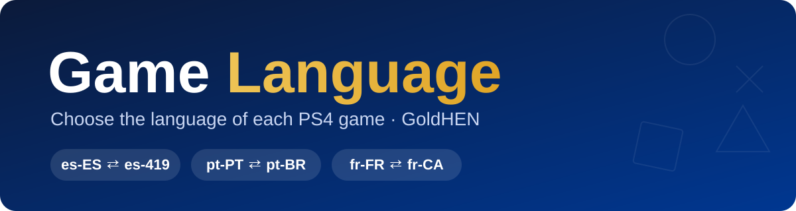
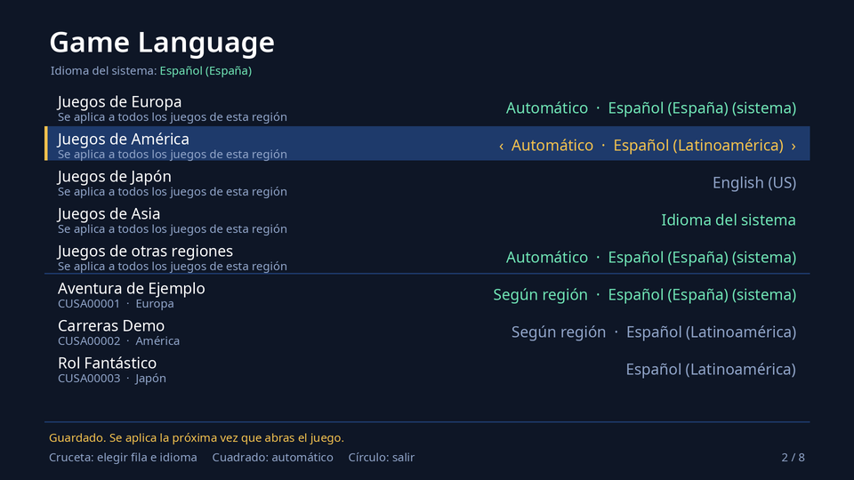
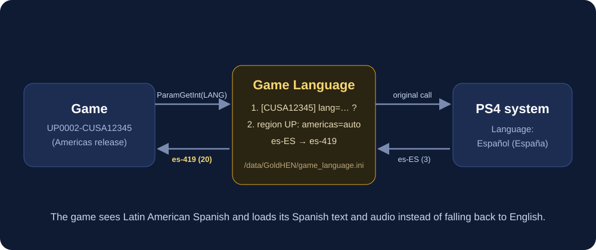

<p align="center"></p>

<p align="center"><a href="README.md">English</a> · <b>Español</b></p>

**Game Language** te permite elegir el idioma de cada juego en una PS4 con [GoldHEN](https://github.com/GoldHEN/GoldHEN), sin cambiar el idioma del sistema.

La PS4 trata las variantes regionales como idiomas distintos: *Español (España)* y *Español (Latinoamérica)*, *Portugués (Portugal)* y *Portugués (Brasil)*, *Francés* y *Francés (Canadá)*. Los juegos europeos suelen traer solo la variante europea y los americanos solo la americana. Si la consola usa la otra variante, el juego arranca en **inglés**. Game Language lo resuelve automáticamente y, además, te deja elegir cualquier idioma para cualquier juego.

<p align="center"><br><sub>Maqueta de la app con juegos de ejemplo.</sub></p>

## Instalación

1. Descarga `GameLanguage.pkg` de la [última versión](https://github.com/Jorditomasg/ps4-game-language/releases/latest).
2. Instálalo como cualquier otro paquete (por ejemplo, desde un USB con el *Package Installer* de GoldHEN).
3. Abre **Game Language** desde la pantalla de inicio.

Al abrirse, la app instala o actualiza el plugin en `/data/GoldHEN/plugins/` y lo añade a `/data/GoldHEN/plugins.ini`. Antes de modificar `plugins.ini`, guarda una copia como `plugins.ini.bak`. No necesitas FTP ni PC.

## Uso

La app tiene dos partes: una fila por **región** (Europa, América, Japón, Asia y otras) y, debajo, tus **juegos** instalados. Al abrir un juego, recibe el idioma de su región, salvo que hayas elegido un idioma para ese juego.

| Opción | Filas de región | Filas de juego |
|---|---|---|
| **Automático** / **Según región** (por defecto) | La variante que le corresponde: los juegos europeos reciben *Español (España)* y los americanos *Español (Latinoamérica)* (igual con portugués y francés) | El idioma de la región del juego |
| **Idioma del sistema** | El idioma del sistema | El idioma del sistema |
| **Un idioma concreto** | Ese idioma para todos los juegos de la región | Ese idioma para este juego |

El idioma del sistema siempre aparece en verde y marcado como *(sistema)*, para que veas cuándo lo usará un juego.

| Botón | Acción |
|---|---|
| Cruceta arriba / abajo | Elegir fila (L1 / R1 avanzan una página) |
| Cruceta izquierda / derecha, Equis | Cambiar el idioma |
| Cuadrado | Volver a *Automático* |
| Círculo | Salir |

Cada cambio se guarda al momento y se aplica la próxima vez que abras el juego. Cuando el plugin cambia el idioma de un juego, la consola muestra un aviso como `Game Language CUSA12345: es-ES -> es-419`.

## Cómo funciona

<p align="center"></p>

El paquete tiene dos partes:

- **La app** (`app/`) lee la lista de juegos instalados (de su `param.sfo`), instala el plugin y guarda tus elecciones en `/data/GoldHEN/game_language.ini`.
- **El plugin** (`plugin/`), que GoldHEN carga en cada juego, lee ese archivo al arrancar el juego y responde a `sceSystemServiceParamGetInt(LANG)` con el idioma que elegiste.

La región sale del Content ID del juego: `EP` = Europa, `UP` = América, `JP` = Japón, `HP` = Asia y cualquier otro = otras. *Automático* cambia estas parejas a la variante de la región del juego: es-ES ⇄ es-419, pt-PT ⇄ pt-BR, fr-FR ⇄ fr-CA. Con otros idiomas, y en Japón, Asia y otras regiones, *Automático* mantiene el idioma del sistema.

Por qué por región: los archivos de un juego no indican qué idiomas trae (el `param.sfo` solo tiene su nombre traducido), así que el plugin no puede comprobarlo. La región es la pista más fiable.

<details>
<summary>Formato del archivo de ajustes</summary>

La app escribe este archivo por ti, pero también puedes editarlo a mano:

```ini
[default]
europe=auto       ; auto = Automático, system = Idioma del sistema, o un código de idioma
americas=es-419
japan=en-US
asia=system
other=auto

[CUSA12345]
lang=es-ES        ; solo este juego (un código de idioma o system)
```

Códigos de idioma: `ja en-US fr-FR es-ES de it nl pt-PT ru ko zh-Hant zh-Hans fi sv da no pl pt-BR en-GB tr es-419 ar fr-CA cs hu el ro th vi id`.
</details>

## Limitaciones

- El juego tiene que incluir el idioma que eliges. Game Language solo cambia el idioma que ve el juego; no añade traducciones.
- La región es una pista, no una garantía: algunas ediciones mundiales traen las dos variantes y algunos juegos no traen el idioma que sugiere su región. Para corregirlo, elige un idioma para ese juego.
- Algunos juegos guardan el idioma en sus propios ajustes o en la partida. En esos casos, usa el menú de idioma del juego.
- La fuente de la app no tiene caracteres japoneses, chinos, coreanos, árabes ni tailandeses. Los nombres en esos alfabetos se ven solo con sus letras latinas o con el ID del juego.
- De momento solo está comprobado con tests unitarios y con la compilación en CI. Se agradecen pruebas en consolas reales.

Licencia: [GPL-3.0](LICENSE)
