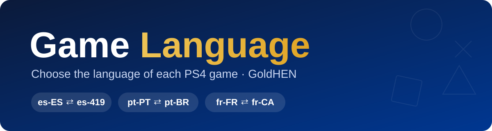
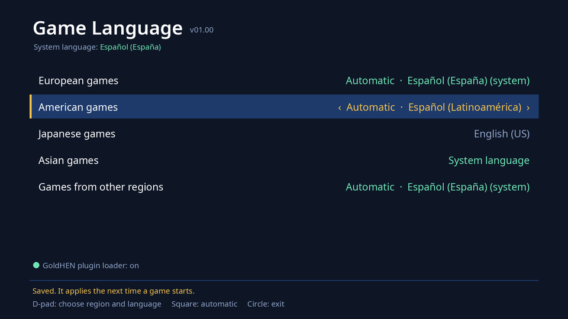

<p align="center"></p>

<p align="center"></p>

Choose the language PS4 games start in, by the game's region.

PS4 games from Europe usually include *Español (España)* and games from America *Español (Latinoamérica)*. If your console uses the other one, the game starts in English. Game Language fixes that.

## Requirements

- [GoldHEN](https://github.com/GoldHEN/GoldHEN) with the plugin loader on: GoldHEN settings → Plugin settings → Enable Plugin Loader. The app shows a green dot when it is on.

## Use

1. Install `GameLanguage-v….pkg` from the [latest release](https://github.com/Jorditomasg/ps4-game-language/releases/latest).
2. Open **Game Language**. It installs its GoldHEN plugin by itself.
3. Choose a language for each region: **Automatic**, **System language** or any language. Your system language is shown in green.

Changes apply the next time a game starts. The game must include the chosen language.

## Build

```sh
export OO_PS4_TOOLCHAIN=/path/to/OpenOrbis/PS4Toolchain GOLDHEN_SDK=/path/to/GoldHEN_Plugins_SDK
make        # app/IV0000-GLNG00001_00-GAMELANGUAGE0000.pkg
make test
```

Credits: [GoldHEN Plugins SDK](https://github.com/GoldHEN/GoldHEN_Plugins_SDK), [OpenOrbis](https://github.com/OpenOrbis/OpenOrbis-PS4-Toolchain), [stb_truetype](https://github.com/nothings/stb), [Noto Sans](app/assets/fonts/OFL.txt). License: [GPL-3.0](LICENSE).
